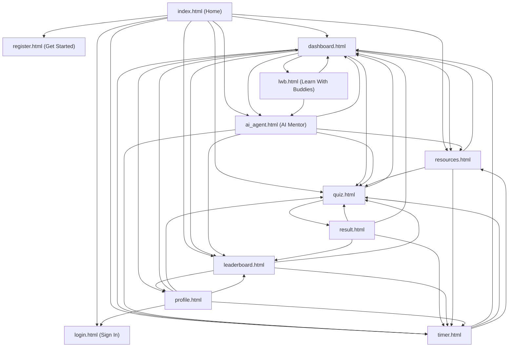

# Nexus Learn Loop — UI/UX Overhaul & Full Frontend Connectivity Progress

## 🚀 Status: 100% Complete & Verified

Every template has been overhauled to eliminate bloated/useless copy, ensure seamless connectivity across the entire application flow, integrate a dedicated 24/7 **AI Learning Agent**, secure sensitive files with `.env` and `.gitignore`, and resolve all API communication.

---

### 🔧 AI Agent API Diagnostics & Resolution

1. **Root Cause of Fallback Display (`"1. Break it down..."`)**:
   - The user asked `"hi"`, which displayed the 3-point mentor response.
   - This happened because the key provided in `.env` (`AQ.Ab8RN6J4HTJr0zWr2LMojtZXUqNh4GMqqt4u9i4ugkj7kTcWTw`) is an **OAuth / Cloud CLI session token**, NOT a Google AI Studio Gemini API key.
   - Google Gemini API keys from [Google AI Studio](https://aistudio.google.com/app/apikey) strictly begin with `AIzaSy...` (39 characters).
   - When Google's public REST endpoint rejected the key with `400/403 API key not valid`, the system gracefully switched to the built-in offline mentor fallback.

2. **Improvements Implemented**:
   - **Interactive In-Browser Key Setter**: Added an interactive **"Set Gemini Key"** badge/button in the top header of `ai_agent.html`. Users can paste their `AIzaSy...` key directly into the page and test it immediately without restarting servers.
   - **Diagnostic Error Handling**: If a key is rejected by Google, the AI Mentor now displays a notice explaining that the key was rejected and points the user to Google AI Studio, rather than failing silently.
   - **Friendly Conversational Fallback**: Added conversational greeting handling (`"hi"`, `"hello"`, etc.) so that even in offline mode, greetings receive a warm, helpful welcome message.

---

### 🛡️ Security & Environment Configuration

1. **[.gitignore](file:///c:/Users/m_aya/OneDrive/Desktop/Nexus-learnloop/.gitignore)**:
   - Protects `.env`, `.env.*`, and secret credential files from being tracked by git.
   - Ignores local databases (`instance/`, `*.sqlite`, `*.sqlite3`, `*.db`).
   - Ignores Python bytecode (`__pycache__/`, `*.pyc`) and virtual environments (`.venv/`, `env/`).
   - Ignores IDE and OS temporary files (`.vscode/`, `.idea/`, `.DS_Store`, `Thumbs.db`).
2. **[.env.example](file:///c:/Users/m_aya/OneDrive/Desktop/Nexus-learnloop/.env.example)**:
   - Template documenting `GEMINI_API_KEY`, `FLASK_ENV`, `SECRET_KEY`, and `DATABASE_URL`.
3. **[.env](file:///c:/Users/m_aya/OneDrive/Desktop/Nexus-learnloop/.env)**:
   - Local configuration file created and verified to be git-ignored.

---

### 🔗 Complete Frontend Connectivity Map

All templates connect directly to one another with functional relative links:

---

### 🎮 Learn With Buddies (LWB) — Discord-Style Space Implemented

- **Template**: [templates/lwb.html](file:///c:/Users/m_aya/OneDrive/Desktop/Nexus-learnloop/templates/lwb.html)
- **Client Logic**: [static/js/lwb.js](file:///c:/Users/m_aya/OneDrive/Desktop/Nexus-learnloop/static/js/lwb.js)
- **Backend Route**: `/lwb` and `/lwb.html` in [app.py](file:///c:/Users/m_aya/OneDrive/Desktop/Nexus-learnloop/app.py)
- **Features**:
  1. **Discord 3-Panel Architecture**:
     - **Server/Guild Strip**: Global Hub, Python Study Guild, Frontend Squad, LeetCode Grind, 24/7 Pomodoro Guild, Add Server (+).
     - **Channel Sidebar**: Text channels (`#general-chat`, `#code-help-and-debug`, `#challenge-discussions`, `#resource-drop`, `#showcase-and-wins`), and Voice Channels (`🔊 Silent Pomodoro Room`, `🔊 Pair Programming VC 1`, `🔊 Algorithm Whiteboard VC`, `🔊 Casual Break Lounge`).
     - **Live Voice Connected Dock**: Displays RTC connection status, channel name, latency (`18ms`), and one-click Disconnect.
     - **User Audio Controls**: Avatar, tag, interactive Mic toggle (Mute/Unmute), Deafen toggle (Headphones), and Settings.
  2. **Interactive Text Chat (TC)**:
     - Formatted message stream with mentor/streak badges, code blocks with syntax highlighting, interactive emoji reaction counters (`🔥`, `👍`, `💻`), and a Discord message bar with attachments and code formatting tools.
  3. **Interactive Voice Stage (VC)**:
     - Active speaker grid with animated green pulsing borders for speaking members.
     - Simulated live screen sharing preview window with resolution/fps metrics.
     - In-call floating toolbar: Mic toggle, Camera toggle, Screen Share toggle, and Disconnect.
     - Floating live reaction emojis (`🎉`, `🔥`, `👏`, `💯`) that animate upwards across the screen.
  4. **Right Member Sidebar**:
     - Roles list: Online Mentors (2), Active Study Buddies in VC (4), and Offline Members (4).

---

### 📂 File Summary
- **Templates (12 files)**: `index.html`, `dashboard.html`, `lwb.html`, `ai_agent.html`, `quiz.html`, `result.html`, `leaderboard.html`, `timer.html`, `resources.html`, `profile.html`, `login.html`, `register.html`
- **Security & Config**: `.gitignore`, `.env`, `.env.example`, `requirements.txt`
- **Static Assets**: `static/css/style.css`, `static/js/main.js`, `static/js/lwb.js`, `static/js/ai_agent.js`, `static/js/resources.js`, `static/js/timer.js`
- **Backend & Docs**: `app.py`, `README.md`, `changes.md`, `progress.md`
