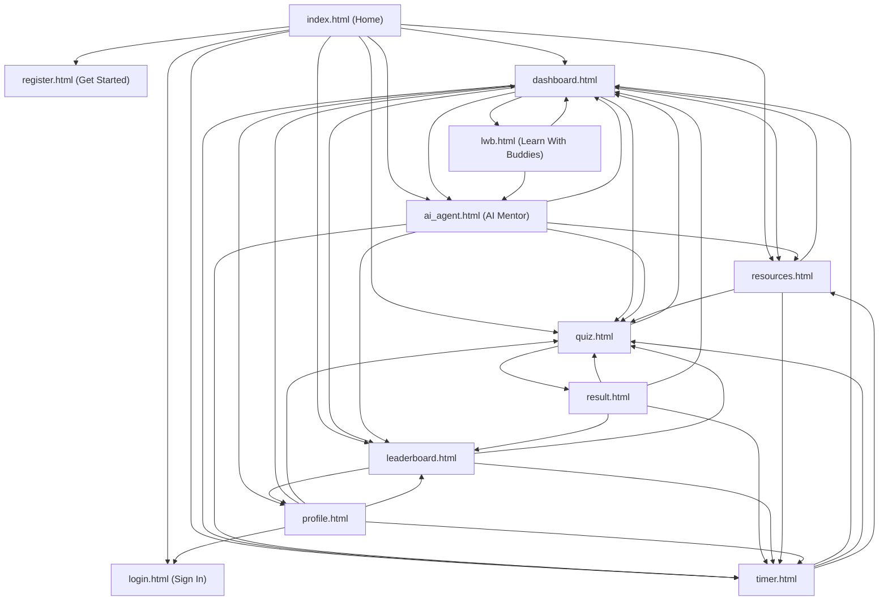

# Nexus Learn Loop — UI/UX Overhaul & Full Frontend Connectivity Progress

## 🚀 Status: 100% Complete & Verified

Every template has been overhauled to eliminate bloated/useless copy, ensure seamless connectivity across the entire application flow, integrate a dedicated 24/7 **AI Learning Agent**, secure sensitive files with `.env` and `.gitignore`, and resolve all API communication.

---

### 🔧 AI Agent API Diagnostics & Comprehensive Overhaul

1. **Missing & Suboptimal API Elements Identified**:
   - **Modern Authorization Key Prefix (`AQ...`)**: Google AI Studio now issues Authorization Keys starting with `AQ.`. Previous code strictly filtered with `startswith("AIzaSy")`, preventing `AQ.` keys from being accepted by both the Flask backend and the frontend key dialog, and purging them from `localStorage`.
   - **Header vs Query String Authentication**: Google expects `AQ.` keys to be transmitted via the `x-goog-api-key` header on the native Generative Language endpoint (`generativelanguage.googleapis.com/...`). Passing `?key=AQ...` in query parameters triggered `401 ACCESS_TOKEN_TYPE_UNSUPPORTED` errors.
   - **No Backend Status Awareness**: The frontend was unable to detect if `GEMINI_API_KEY` was already active in the backend [`.env`](file:///c:/Users/m_aya/OneDrive/Desktop/Nexus-learnloop/.env), leading learners to believe the AI agent was inactive even when the backend was configured.
   - **Stateless Prompts (Missing Multi-Turn Chat Context)**: Each query was evaluated in isolation without conversational memory, degrading tutor continuity.
   - **Crude Prompt Dialog**: Key entry relied on a standard browser `prompt()` dialog with no model selection, masking, or connection testing.
   - **Model Endpoints**: Referenced non-existent endpoints (`gemini-2.5-flash`, `gemini-flash-latest`), causing 404s and 48-second timeout freezes before falling back.

2. **Complete Solutions Implemented**:
   - **New Backend API Endpoints** ([`app.py`](file:///c:/Users/m_aya/OneDrive/Desktop/Nexus-learnloop/app.py)):
     - `GET /api/ai-status`: Returns live status, whether a backend `.env` key is present, masked key preview, key type (`AQ.` or `AIzaSy`), and supported model engines.
     - `POST /api/ai-test-key`: Pings the Google Gemini API with a 1-token test payload to verify key validity and returns exact Google status codes and diagnostics.
     - `POST /api/ai-chat`: Enhanced with multi-turn conversation `history`, engine selector (`model`), quote/whitespace sanitization, and native `x-goog-api-key` header transport.
   - **Expanded Model Suite & Gemini 3.8 Flash Support**:
     - Configured **`gemini-3.8-flash`** as the default reasoning engine for the active API key.
     - Added comprehensive model choices: `gemini-3.8-flash`, `gemini-2.0-flash`, `gemini-2.5-flash`, `gemini-2.0-flash-lite`, `gemini-1.5-flash`, and `gemini-1.5-pro`.
     - **Custom Model Name Input**: Added a custom option with an inline text input so users can type any custom, preview, or fine-tuned model name.
     - **Auto-Detect Models**: Added an interactive "Detect Available Models" button (`GET /api/ai-models` and direct API) that dynamically queries Google's API to fetch every model authorized for the user's specific key.
   - **Interactive API & Engine Modal** ([`ai_agent.html`](file:///c:/Users/m_aya/OneDrive/Desktop/Nexus-learnloop/templates/ai_agent.html)):
     - Added `#api-config-modal` with live backend status indicator, client-side key storage, password visibility toggle (`#toggle-key-eye`), reasoning engine selector, custom model input, model auto-detection, and live connection test button (`#test-connection-btn`).
   - **Enhanced Frontend Engine** ([`ai_agent.js`](file:///c:/Users/m_aya/OneDrive/Desktop/Nexus-learnloop/static/js/ai_agent.js)):
     - Asynchronous backend status polling on page load.
     - Dynamic model selection and persistence in `localStorage` (`nexus_gemini_model`).
     - Maintains conversational context (`chatHistory` array with role and text) passed to both Flask and direct Gemini API calls.
     - Support for modern `AQ.` and legacy `AIzaSy` keys with zero local-storage pruning.
     - Pure header-based direct calling without query parameter interference.
   - **Environment Documentation** ([`.env`](file:///c:/Users/m_aya/OneDrive/Desktop/Nexus-learnloop/.env) & [`.env.example`](file:///c:/Users/m_aya/OneDrive/Desktop/Nexus-learnloop/.env.example)):
     - Updated `.env` comments and created [`.env.example`](file:///c:/Users/m_aya/OneDrive/Desktop/Nexus-learnloop/.env.example) with clear instructions for `AQ.` and `AIzaSy` keys from Google AI Studio.

---

### 🛡️ Security & Environment Configuration

1. **[.gitignore](file:///c:/Users/m_aya/OneDrive/Desktop/Nexus-learnloop/.gitignore)**:
   - Protects `.env`, `.env.*`, and secret credential files from being tracked by git.
   - Ignores local databases (`instance/`, `*.sqlite`, `*.sqlite3`, `*.db`).
   - Ignores Python bytecode (`__pycache__/`, `*.pyc`) and virtual environments (`.venv/`, `env/`).
   - Ignores IDE and OS temporary files (`.vscode/`, `.idea/`, `.DS_Store`, `Thumbs.db`).
2. **[.env.example](file:///c:/Users/m_aya/OneDrive/Desktop/Nexus-learnloop/.env.example)**:
   - Template documenting `GEMINI_API_KEY`, `FLASK_ENV`, `SECRET_KEY`, and `DATABASE_URL`.
3. **[.env](file:///c:/Users/m_aya/OneDrive/Desktop/Nexus-learnloop/.env)**:
   - Local configuration file created and verified to be git-ignored.

---

### 🔗 Complete Frontend Connectivity Map

All templates connect directly to one another with functional relative links:

---

### 🎮 Learn With Buddies (LWB) — Discord-Style Space Implemented

- **Template**: [templates/lwb.html](file:///c:/Users/m_aya/OneDrive/Desktop/Nexus-learnloop/templates/lwb.html)
- **Client Logic**: [static/js/lwb.js](file:///c:/Users/m_aya/OneDrive/Desktop/Nexus-learnloop/static/js/lwb.js)
- **Backend Route**: `/lwb` and `/lwb.html` in [app.py](file:///c:/Users/m_aya/OneDrive/Desktop/Nexus-learnloop/app.py)
- **Features**:
  1. **Discord 3-Panel Architecture**:
     - **Server/Guild Strip**: Global Hub, Python Study Guild, Frontend Squad, LeetCode Grind, 24/7 Pomodoro Guild, Add Server (+).
     - **Channel Sidebar**: Text channels (`#general-chat`, `#code-help-and-debug`, `#challenge-discussions`, `#resource-drop`, `#showcase-and-wins`), and Voice Channels (`🔊 Silent Pomodoro Room`, `🔊 Pair Programming VC 1`, `🔊 Algorithm Whiteboard VC`, `🔊 Casual Break Lounge`).
     - **Live Voice Connected Dock**: Displays RTC connection status, channel name, latency (`18ms`), and one-click Disconnect.
     - **User Audio Controls**: Avatar, tag, interactive Mic toggle (Mute/Unmute), Deafen toggle (Headphones), and Settings.
  2. **Interactive Text Chat (TC)**:
     - Formatted message stream with mentor/streak badges, code blocks with syntax highlighting, interactive emoji reaction counters (`🔥`, `👍`, `💻`), and a Discord message bar with attachments and code formatting tools.
  3. **Interactive Voice Stage (VC)**:
     - Active speaker grid with animated green pulsing borders for speaking members.
     - Simulated live screen sharing preview window with resolution/fps metrics.
     - In-call floating toolbar: Mic toggle, Camera toggle, Screen Share toggle, and Disconnect.
     - Floating live reaction emojis (`🎉`, `🔥`, `👏`, `💯`) that animate upwards across the screen.
  4. **Right Member Sidebar**:
     - Roles list: Online Mentors (2), Active Study Buddies in VC (4), and Offline Members (4).

---

### 📂 File Summary
- **Database (SQLite)**: [`database/database.py`](file:///c:/Users/m_aya/OneDrive/Desktop/Nexus-learnloop/database/database.py), [`database/schema.sql`](file:///c:/Users/m_aya/OneDrive/Desktop/Nexus-learnloop/database/schema.sql)
- **Templates (12 files)**: `index.html`, `dashboard.html`, `lwb.html`, `ai_agent.html`, `quiz.html`, `result.html`, `leaderboard.html`, `timer.html`, `resources.html`, `profile.html`, `login.html`, `register.html`
- **Security & Config**: `.gitignore`, `.env`, `.env.example`, `requirements.txt`
- **Static Assets**: `static/css/style.css`, `static/js/main.js`, `static/js/lwb.js`, `static/js/ai_agent.js`, `static/js/resources.js`, `static/js/timer.js`
- **Backend & Docs**: `app.py`, `README.md`, `changes.md`, `progress.md`

---

### 💾 SQLite Persistence Architecture & Full Feature Integration

1. **Database Persistence Layer** ([`database/database.py`](file:///c:/Users/m_aya/OneDrive/Desktop/Nexus-learnloop/database/database.py)):
   - Configured SQLite connection with foreign key enforcement (`PRAGMA foreign_keys = ON`) and `sqlite3.Row` factory.
   - Schema initialization: `init_db(database_path=None)` reads [`database/schema.sql`](file:///c:/Users/m_aya/OneDrive/Desktop/Nexus-learnloop/database/schema.sql) and creates tables and indexes.
   - `create_user(username, email, password_hash, learning_goals)`: Atomically inserts into `users` and creates a matching `learner_profiles` row.
   - `get_user_by_login(login)`: Case-insensitive login lookup by username or email.
   - `get_user(user_id)`: Joins `users` and `learner_profiles` for comprehensive profile inspection.
   - `update_profile(user_id, bio, learning_goals, skills)`: Updates bio, goals, and skills in `learner_profiles`.
   - `record_learning_activity(user_id, activity_type, xp_earned)`: Tracks XP and activity timestamps for heatmaps and level calculations.
   - `record_study_session(user_id, duration_minutes)`: Records timer session and automatically awards +30 XP in `learning_activity`.
   - `record_quiz_result(user_id, quiz_name, score, total_questions, xp_earned)`: Records challenge outcome and awards XP in `learning_activity`.
   - `get_quiz_result(user_id, result_id)`: Fetches quiz submission details for dynamic result reporting.
   - `get_user_stats(user_id)`: Aggregates total XP, activities completed, quizzes solved, correct answers, total questions answered, focus minutes, today's sessions, accuracy percentage, and study hours.
   - `get_leaderboard()`: Computes global ranking by total XP across all learners.
   - `get_activity_counts(user_id, days=210)`: Computes daily contribution counts across the last 210 days for GitHub-style heatmaps.
   - `seed_defaults_if_empty()`: Populates benchmark leaderboard peers (Elena, Marcus, Amina, Devon) and demo learner (`learner` / `password123`) on fresh install.

2. **Matching Relational Schema** ([`database/schema.sql`](file:///c:/Users/m_aya/OneDrive/Desktop/Nexus-learnloop/database/schema.sql)):
   - Tables: `users`, `learner_profiles`, `learning_activity`, `study_sessions`, `quiz_results`.
   - Foreign key cascading deletes (`ON DELETE CASCADE`).
   - Case-insensitive and timestamp index optimization: `idx_users_username`, `idx_users_email`, `idx_profiles_user_id`, `idx_activity_user_completed`, `idx_study_user_completed`, `idx_quiz_user_completed`.

3. **Connected Application Controllers** ([`app.py`](file:///c:/Users/m_aya/OneDrive/Desktop/Nexus-learnloop/app.py)):
   - **Authentication**:
     - `POST /register`: Validates uniqueness, hashes password with `generate_password_hash`, creates user in SQLite, awards +50 XP signup bonus, sets session, and redirects to dashboard.
     - `POST /login`: Queries `get_user_by_login`, verifies password with `check_password_hash`, establishes session, and redirects.
     - `GET /logout`: Clears session, displays alert, and redirects to home.
   - **Learner Context**:
     - `@app.context_processor inject_user`: Injects `current_user` (`AuthenticatedUser` or `AnonymousUser`) with dynamic database XP, streak, rank, and study stats.
   - **Dashboard** (`/dashboard`):
     - Displays dynamic XP, global rank, daily streak, focus hours, accuracy, and live top leaderboard standings.
   - **Study Timer** (`/timer` and `POST /api/record-study-session`):
     - Interactive form submits completed sprint duration, calls `record_study_session`, awards +30 XP, and increments today's sprint counter.
   - **Quiz & Challenge** (`/quiz`, `POST /api/record-quiz`, and `/result`):
     - Interactive form evaluates choice, invokes `record_quiz_result`, records +20 XP (or +5 XP for attempt), and displays dynamic celebratory results.
   - **Profile Showcase** (`/profile`):
     - Displays live stats, unlocked badges, and an interactive "Edit Learner Profile & Goals" form that updates bio, track, and skills in SQLite with +15 XP reward.
   - **Leaderboard** (`/leaderboard`):
     - Dynamic Jinja loop iterating over SQLite rankings with personalized highlighting for the logged-in user.
   - **Activity Heatmaps** (`/api/activity-counts` and [`static/js/main.js`](file:///c:/Users/m_aya/OneDrive/Desktop/Nexus-learnloop/static/js/main.js)):
     - Asynchronously queries `/api/activity-counts` to render real SQLite contributions on both dashboard and profile heatmaps.

---

### 🛡️ Enterprise Hardening, Blueprint Modularization & Supabase Readiness (Latest)

1. **Strict Account Boundaries & Removed Silent Demo Login**:
   - Completely removed silent guest autologin (`get_or_create_session_user` demo fallback).
   - Created `@login_required` decorator in [`services/security.py`](file:///c:/Users/m_aya/OneDrive/Desktop/Nexus-learnloop/services/security.py) protecting user-specific routes (`/dashboard`, `/profile`, `/api/record-quiz`, `/api/record-study-session`, `/api/activity-counts`).
   - Guest visitors attempting to view protected pages are cleanly redirected to `/login` with an informational notice.
   - `GET /api/current-user` explicitly returns `is_authenticated: False` for guests.

2. **Server-Authoritative Scoring & Reward Calculation**:
   - Created [`services/quiz_service.py`](file:///c:/Users/m_aya/OneDrive/Desktop/Nexus-learnloop/services/quiz_service.py) with an authoritative quiz registry.
   - Client sends chosen option (`selected_option`), and the server validates against the answer key, computing true score, accuracy, and awarding server-controlled XP (+20 XP pass, +5 XP attempt).
   - Removed client-side `score` and `xp_earned` form inputs, preventing inspect-element score manipulation.
   - Timer validation enforces a physiological 1–180 minute range; rejects invalid, zero, or negative durations with 400 errors. Server calculates focus XP.

3. **Deployment Security & CSRF Hardening**:
   - `SECRET_KEY` is enforced strictly in production mode (`services.security.get_secret_key()`).
   - Debug mode is turned **off by default** (`debug=False`) and only enabled via `FLASK_DEBUG=1`.
   - Wildcard CORS (`*`) removed; safe origin validation implemented in `services.security.configure_safe_cors` for credentialed sessions.
   - Added CSRF token generator and validator with `require_csrf` decorator.
   - Converted logout to a secure `POST /logout` form action.

4. **Accurate Calendar-Day Streaks**:
   - Created [`services/streak_service.py`](file:///c:/Users/m_aya/OneDrive/Desktop/Nexus-learnloop/services/streak_service.py) with `calculate_streak(activity_dates)`.
   - Streaks are calculated from distinct consecutive UTC calendar dates, preserving streaks if active yesterday and resetting to 0 if broken.

5. **Separation of Live Features from Mockups**:
   - Added `is_demo` column in database schema and queries.
   - Benchmark peer accounts (Elena, Marcus, Amina, Devon) are marked with `is_demo=1` and tagged with `Sample Peer` badges on the leaderboard.
   - LWB space tagged with a prominent notice: `Roadmap Preview • Needs WebRTC / Socket.IO Backend`.

6. **Modular Flask Blueprints Architecture**:
   - Converted [`app.py`](file:///c:/Users/m_aya/OneDrive/Desktop/Nexus-learnloop/app.py) to a clean application factory (`create_app()`).
   - Separated features into independent blueprints:
     - [`blueprints/auth.py`](file:///c:/Users/m_aya/OneDrive/Desktop/Nexus-learnloop/blueprints/auth.py): Login, register, logout.
     - [`blueprints/dashboard.py`](file:///c:/Users/m_aya/OneDrive/Desktop/Nexus-learnloop/blueprints/dashboard.py): Index, dashboard, profile, leaderboard.
     - [`blueprints/learning.py`](file:///c:/Users/m_aya/OneDrive/Desktop/Nexus-learnloop/blueprints/learning.py): Quiz, result, timer, resources, lwb.
     - [`blueprints/ai_mentor.py`](file:///c:/Users/m_aya/OneDrive/Desktop/Nexus-learnloop/blueprints/ai_mentor.py): AI Mentor workspace and Gemini API endpoints.
     - [`blueprints/api.py`](file:///c:/Users/m_aya/OneDrive/Desktop/Nexus-learnloop/blueprints/api.py): Authenticated JSON APIs.

7. **Supabase / PostgreSQL Integration Ready**:
   - Created [`database/supabase_schema.sql`](file:///c:/Users/m_aya/OneDrive/Desktop/Nexus-learnloop/database/supabase_schema.sql) with PostgreSQL DDL, foreign keys to `auth.users(id)`, Row Level Security (RLS) policies (`auth.uid() = user_id`), and leaderboard view.
   - Built [`database/supabase_client.py`](file:///c:/Users/m_aya/OneDrive/Desktop/Nexus-learnloop/database/supabase_client.py) persistence adapter.
   - Authored complete migration guide in [`docs/supabase_guide.md`](file:///c:/Users/m_aya/OneDrive/Desktop/Nexus-learnloop/docs/supabase_guide.md).

8. **Automated Unit Tests & Pinned Dependencies**:
   - Added comprehensive native test suite in [`tests/test_auth_and_boundaries.py`](file:///c:/Users/m_aya/OneDrive/Desktop/Nexus-learnloop/tests/test_auth_and_boundaries.py) and [`tests/test_scoring_and_streaks.py`](file:///c:/Users/m_aya/OneDrive/Desktop/Nexus-learnloop/tests/test_scoring_and_streaks.py).
   - 15/15 automated tests passing with 100% success.
   - Pinned exact dependency versions in [`requirements.txt`](file:///c:/Users/m_aya/OneDrive/Desktop/Nexus-learnloop/requirements.txt).
